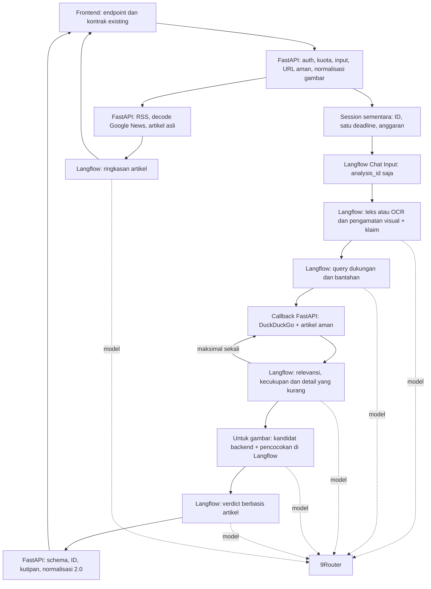

# Langflow orchestration - Faktain

Langflow 1.12.1 mengatur seluruh tugas AI normal. FastAPI menyediakan aplikasi,
keamanan, pencarian/pengambilan bukti, anggaran analisis, dan validasi akhir.
Model tetap diakses melalui provider OpenAI Compatible 9Router di Langflow.
Tidak ada agent, memory, vector database, MCP, atau tool model yang mengambil URL.

## Tiga flow dan pembagian tanggung jawab

| Ekspor | Tugas AI di Langflow |
| --- | --- |
| [text-verification.json](../langflow/text-verification.json) | Ekstraksi klaim dari teks/artikel, lalu pemeriksaan bukti bersama |
| [image-verification.json](../langflow/image-verification.json) | OCR/pengamatan visual dan klaim tanpa verdict awal, lalu pemeriksaan bukti dan pencocokan gambar |
| [news-summary.json](../langflow/news-summary.json) | Ringkasan hanya dari isi artikel asli yang telah diambil FastAPI |

Generator juga membuat alias lokal `flow.json` yang tidak disertakan di Git. Ekspor memakai
format target 1.12.1, komponen bawaan Chat Input, Language Model dan Chat Output,
serta komponen Faktain kecil untuk kontrak workflow/callback. Handle model bawaan
memanggil 9Router; komponen Faktain menjalankan urutan tetap dengan validasi.
Flow tidak memanggil ulang pipeline AI lama di FastAPI.



Pemeriksaan bukti teks/gambar berasal dari `langflow/workflow.py` yang sama;
prompt dipelihara di `backend/app/services/verification_prompts.py`, lalu
`langflow/build_flows.py` menyisipkannya ke ekspor. Tidak perlu menyalin prompt
antar-flow secara manual. Regenerasikan ekspor setelah mengubah sumber:

```powershell
.venv/Scripts/python.exe langflow/build_flows.py --url http://127.0.0.1:7860
```

Generator membaca template komponen dan memvalidasi komponen khusus di instance
target; perintah ini tidak mengimpor flow atau mengubah provider.

## Konfigurasi

1. Jalankan Langflow 1.12.1 secara terpisah dan impor ketiga ekspor melalui
   Upload a flow. Simpan ID masing-masing dari API access.
2. Di Settings > Model Providers > OpenAI Compatible, konfigurasi URL 9Router
   reachable (termasuk `/v1`) dan API key. Pilih ID model teks yang tersedia pada
   handle Language Model ketiga flow. Komponen menggunakan nama handle
   `text_model`: loader native 1.12.1 melewati resolusi secret `load_from_db`
   bila field `model` mendapat edge masuk. Nama handle ini menghindari bug
   tersebut sehingga Service Key global tetap di-resolve. Untuk flow gambar, konfigurasi handle
   vision dengan model yang benar-benar mendukung gambar. Backend tetap
   memeriksa katalog model; nama model saja bukan bukti dukungan vision.
3. Setiap komponen Faktain memerlukan Backend URL reachable dan Service Key.
   Gunakan variabel global Langflow bertipe credential untuk Service Key bila
   tersedia; nilainya harus sama dengan `LANGFLOW_SERVICE_KEY` di FastAPI.
   Backend URL merupakan konfigurasi komponen, bukan keluaran model. Jangan
   menaruh key, endpoint internal, atau kredensial provider di prompt/Chat Input.
4. Isi `backend/.env` tanpa menimpa konfigurasi existing yang tidak terkait:

```dotenv
ORCHESTRATION_BACKEND=langflow
LANGFLOW_URL=http://localhost:7860
LANGFLOW_API_KEY=replace-with-langflow-instance-key
LANGFLOW_SERVICE_KEY=replace-with-private-shared-service-key
LANGFLOW_TEXT_FLOW_ID=replace-with-text-flow-id
LANGFLOW_IMAGE_FLOW_ID=replace-with-image-flow-id
LANGFLOW_SUMMARY_FLOW_ID=replace-with-summary-flow-id
LANGFLOW_NATIVE_FALLBACK=true
LLM_PROVIDER=9router
LLM_BASE_URL=http://localhost:20128/v1
LLM_API_KEY=replace-with-router-key
LLM_MODEL=replace-with-exact-text-model-id
LLM_VISION_MODEL=replace-with-confirmed-vision-model-id
SEARCH_PROVIDER=duckduckgo
VERIFICATION_TIMEOUT=100
```

Contoh menggunakan localhost untuk pengembangan; dalam container alamat ini
menunjuk container sendiri. Konfigurasi provider Langflow tidak otomatis membaca
backend `.env`. `LLM_*` backend digunakan untuk health katalog dan fallback
perbandingan yang terbatas. `LANGFLOW_FLOW_ID` lama bukan pengganti tiga ID baru;
mode `native` bukan jalur AI normal yang didukung lagi.

Untuk provider privat, isi `LANGFLOW_SSRF_ALLOWED_HOSTS` dengan host 9Router
milik operator, dipisahkan koma bila lebih dari satu (`host-a,host-b`), sebelum
menyimpan provider lalu restart proses. Parser versi target membaca raw environment
dengan split koma; array JSON bukan format yang benar. Jangan melonggarkan
pengamanan pengambilan artikel FastAPI; allowlist provider tidak membuat URL dari
model menjadi tepercaya. Dokumentasi resmi: [provider OpenAI Compatible](https://docs.langflow.org/bundles-openai-compatible),
[run API](https://docs.langflow.org/api-flows-run), dan [source versi 1.12.1](https://github.com/langflow-ai/langflow/tree/1.12.1).

FastAPI memanggil `POST /api/v1/run/{flow_id}` dengan `x-api-key`, Chat Input/Output,
`input_value` JSON berisi hanya `analysis_id`, dan `session_id` sementara. Keluaran
dibaca dari `outputs[0].outputs[0].results.message.text`. ID hanya berlaku selama
request aktif; menjalankan flow manual dengan ID acak bukan demo yang valid.

## Callback internal dan batas

`POST /internal/analyses/{analysis_id}/{action}` memerlukan
`X-Faktain-Service-Key`; token pengguna/Firebase tidak memberikan akses.
Endpoint tidak ditampilkan dalam OpenAPI publik. Body dibatasi 16 KiB, payload
strict, setiap session memakai lock, dan callback session mati ditolak.

| Action | Fungsi |
| --- | --- |
| `context` | Membaca input/session; gambar berupa data URL yang telah dinormalisasi |
| `register` | Mendaftarkan maksimal tiga klaim dan observasi; backend menerbitkan `C1`-`C3` |
| `search` | Query terikat claim ID, putaran 0/1; DuckDuckGo dan unduhan dilakukan backend |
| `candidates` | Maksimal dua gambar dari artikel sumber backend, diambil dengan URL safety existing |
| `matches` | Mendaftarkan enum hasil pencocokan hanya untuk ID kandidat yang disetujui |
| `ai-call` | Reservasi tahap, jumlah panggilan dan token sebelum pemanggilan model |

Backend membatasi tiga klaim, lima percobaan pengambilan artikel total (termasuk
kegagalan), dua percobaan kandidat, tiga query per putaran, dua putaran pencarian
(awal + satu tambahan), delapan panggilan AI, dan 10.000 token keluaran yang
direservasi. Putaran pertama memakai maksimal tiga slot artikel; tambahan dapat
mengisi sisa hingga lima. ID sumber tidak berubah antar-putaran; kegagalan unduhan
dapat meninggalkan celah penomoran. Retry SDK model dinonaktifkan agar reservasi
satu panggilan tidak diam-diam menghasilkan beberapa request provider.

Satu deadline monotonic default 100 detik berlaku bagi seluruh analisis, termasuk
pengambilan URL awal, callback, model, pencarian tambahan dan fallback. Tahap
berikutnya hanya memperoleh sisa waktu. Bukti cukup tidak memicu tambahan; bukti
kurang hanya menghasilkan query tambahan jika detailnya dapat dicari. Jumlah
artikel tidak menentukan kecukupan. Model tidak dapat memilih URL callback,
URL gambar, shell, file, credentials atau tool bebas.

Session berada di memori **proses FastAPI yang menerima analisis**. Callback wajib
kembali ke proses tersebut. Multiworker/multi-instance tanpa affinity tidak
didukung; implementasi ini tidak menambahkan penyimpanan terdistribusi.

## Validasi, kegagalan dan fallback

JSON yang dapat diparse belum cukup. Setiap tahap memvalidasi field, tipe, enum,
batas panjang dan claim ID. Hasil akhir harus memuat setiap ID klaim tepat sekali;
ID sumber dan kutipan harus terdapat dalam teks artikel yang benar-benar diambil.
Judul/URL akhir berasal dari backend. Snippet pencarian dan ingatan model tidak
menjadi evidence. Normalisasi akhir tetap memakai `schema_version: "2.0"`, lima
verdict klaim dan kontrak konteks gambar existing; tidak ada confidence score.

Untuk gambar, `SAME_IMAGE` membutuhkan fitur khas dari foto yang sama; subjek
serupa belum cukup. Tanpa kecocokan, konteks gambar tetap insufficient. Kecocokan
visual tidak membuktikan keaslian, deepfake, waktu atau lokasi. Tanggal publikasi,
kejadian, pengambilan foto dan referensi pengguna harus dibedakan.

Kegagalan layanan, timeout dan output invalid memperoleh limitations berbeda.
Tahap gagal tidak menghasilkan kesimpulan dari ingatan model. Bila klaim backend
serta artikel sudah tersedia, waktu/anggaran masih cukup, dan
`LANGFLOW_NATIVE_FALLBACK=true`, hanya **perbandingan** boleh memakai satu
panggilan native 9Router. Respons menandai `orchestration: native_fallback` serta
limitation. Hasil ekstraksi/OCR yang sukses tidak diulang. Fallback tidak dapat
mengganti ekstraksi atau OCR yang gagal, dan ringkasan tidak memakai fallback AI
langsung. `orchestration: langflow` pada respons gagal tidak membuktikan flow
selesai: baca verdict dan limitations juga.

## Privasi runtime

Ekspor menonaktifkan Store Messages pada Chat Input/Output. Pesan antar-node
hanya ID session; gambar/input/artikel diambil melalui callback dan dikirim ke
model selama proses. Tidak ada upload file gambar Langflow atau file sementara
yang diperlukan. Backend membersihkan session dalam `finally` dan menolak ID
yang sudah kedaluwarsa. Penyedia model tetap menerima data dan kebijakannya berlaku.

Sebelum memakai input pribadi, konfigurasi proses Langflow dan **verifikasi nilai
aktif**, bukan hanya file environment:

```dotenv
LANGFLOW_TRANSACTIONS_STORAGE_ENABLED=false
LANGFLOW_VERTEX_BUILDS_STORAGE_ENABLED=false
LANGFLOW_SYNC_RESULT_STORAGE_ENABLED=false
LANGFLOW_TELEMETRY_WRITER_ENABLED=false
LANGFLOW_DEACTIVATE_TRACING=true
DO_NOT_TRACK=true
LANGCHAIN_TRACING_V2=false
LANGSMITH_TRACING=false
LANGFLOW_LOG_LEVEL=error
LANGFLOW_MAX_VERTEX_BUILDS_TO_KEEP=0
LANGFLOW_MAX_TRANSACTIONS_TO_KEEP=0
```

Flag storage di atas berasal dari versi 1.12.1: retention nol saja **tidak
mencegah penulisan** transaksi, vertex build atau hasil sinkron. Komponen Faktain
memeriksa konfigurasi privasi dan menolak eksekusi bila guard tidak terpenuhi.
Runtime direstart dan nilai aktif diperiksa: tracing nonaktif; storage transaksi,
vertex build dan hasil sinkron nonaktif; telemetry writer nonaktif; Do Not Track
aktif; tracing LangChain/LangSmith nonaktif. Pemeriksaan database read-only untuk
ID ketiga flow baru mendapati nol record pada `message`, `transaction`,
`vertex_build` dan `job`. Ini memverifikasi instance saat uji; retensi upstream
9Router/provider tetap di luar kendali aplikasi.

Periksa juga tracing pihak ketiga (misalnya LangSmith), telemetry, akses log,
retensi database Langflow dan konfigurasi deployment. Jangan mengaktifkan trace
payload, log request/response, log gambar, token, atau credentials. Mengubah
retensi tidak otomatis menghapus data lama; review dan hapus history lama melalui
mekanisme administrasi yang disetujui. Store Messages false saja tidak membuktikan
privasi runtime. Status pemeriksaan instance aktual dicatat di bawah.

## Pengujian dan status verifikasi

```powershell
.venv/Scripts/python.exe -m pytest -c backend/pytest.ini backend -q
cd frontend
npm run typecheck
npm run lint
npm run test:e2e -- --workers=1
npm run build
```

Tes mock memastikan routing flow, batas callback/deadline, validasi schema/ID/
kutipan, pencarian tambahan, pencocokan gambar dan fallback. Mock tidak membuktikan
impor/eksekusi instance, konektivitas provider, layanan pencarian atau akurasi fakta.
Gunakan [skenario demo](LANGFLOW_DEMOS.md) untuk perjalanan yang terpisah.

Status verifikasi 2026-10-11, target Langflow **1.12.1**:

- Flow perbandingan lama berhasil dikonfigurasi dan dipanggil melalui API:
  HTTP 200, JSON object dengan satu klaim pada input terkontrol.
- Ketiga flow baru berhasil diimpor dan dikonfigurasi melalui API, menggunakan
  native handle model 9Router dan variabel global credential untuk service key.
  Ekspor repository tidak memuat secret; konfigurasi callback/provider tetap kosong.
- Verifikasi teks melalui `/analyze`: HTTP 200, sekitar 5,2 detik, satu klaim,
  jalur Langflow, verdict insufficient karena search dimatikan saat smoke test.
- Verifikasi gambar melalui `/analyze`: HTTP 200, sekitar 8,8 detik; OCR sesuai
  tulisan sintetis, satu klaim, konteks gambar insufficient.
- Ringkasan RSS/berita melalui API publik: HTTP 200, sekitar 4,7 detik, 629
  karakter; artikel asli berhasil diambil sebelum flow meringkasnya.
- Backend: **170 tes lulus**, satu warning AnyIO. Frontend typecheck, lint dan
  production build lulus; empat tes UI dengan mock lulus.
- Satu perjalanan browser live lulus (10,3 detik), menggunakan backend/Langflow/
  9Router aktual. CORS smoke backend memasukkan origin port 3100 melalui environment
  proses; tes frontend memakai port tersebut.
- Konfigurasi privasi runtime dan nol record penyimpanan flow baru diperiksa
  sebagaimana dijelaskan di bagian privasi.

Perjalanan browser live dapat dijalankan setelah layanan dikonfigurasi:

```powershell
cd frontend
$env:FAKTAIN_LIVE_SMOKE = "1"
npm run test:e2e -- langflow-live.spec.ts --workers=1
```

Backend uji live harus mengizinkan origin frontend tes pada port 3100 melalui
`FRONTEND_URL` dan memiliki konfigurasi flow/provider yang sama. Smoke backend
pada port 8000 saat verifikasi terdahulu menggunakan `LLM_WEB_SEARCH=false`
hanya pada environment proses, karena key Exa saat itu belum tersedia. Pada revisi
2026-10-11, pencarian diganti DuckDuckGo dan `backend/.env` menggunakan
`SEARCH_PROVIDER=duckduckgo`, `LLM_WEB_SEARCH=true`, `LLM_WEB_MODE=external`.
Tidak diperlukan key pencarian. Jangan memakai smoke terdahulu untuk mengklaim
pencarian baru telah berhasil.

**Pada smoke awal, belum terverifikasi live:** pencarian DuckDuckGo, pencarian tambahan, pencocokan gambar
kandidat artikel, dan akurasi pemeriksaan fakta. Batas serta kontrak tahap-tahap
tersebut diuji dengan mock; hasil OCR sintetis bukan tolok ukur akurasi dunia nyata.
Keberhasilan impor maupun `orchestration: langflow` saja tidak membuktikan seluruh
retrieval selesai. Tidak ada deployment atau publikasi yang dilakukan.

## MCP untuk membuat dan mengelola flow

MCP development resmi Langflow tersedia pada `http://127.0.0.1:7860/api/v1/agentic/mcp`
melalui transport Streamable HTTP. Client menggunakan header `x-api-key` dari
credential `LANGFLOW_API_KEY`; jangan menyalin nilainya ke repository atau prompt.
Endpoint authoring ini berbeda dari MCP project yang mengekspos flow sebagai tool.
Lihat [dokumentasi Assistant/MCP resmi](https://docs.langflow.org/langflow-assistant).

Pada 2026-10-11 koneksi MCP aktual berhasil diinisialisasi dan menyediakan 32 tool,
termasuk `create_flow`, `add_component`, `configure_component`, `connect_components`,
`get_flow_info`, dan `export_flow`. Ketiga flow Faktain dibaca dan diekspor melalui
MCP; koneksi graph, Store Messages false, serta tidak adanya secret pada hasil
ekspor diperiksa. Flow uji sementara berhasil dibuat, dikonfigurasi, dihubungkan,
dijalankan tanpa model, kemudian dihapus melalui MCP.

Koneksi pengembangan ini menggunakan SDK MCP yang sudah terpasang bersama
Langflow, tanpa dependency baru untuk aplikasi. MCP tidak diberikan kepada model
verifikasi dan tidak ditambahkan ke tiga workflow Faktain. Pengelolaan berikutnya
dapat menggunakan tool authoring MCP; runtime tetap memakai kontrak callback
FastAPI yang dibatasi. Pemeriksaan MCP ini bukan uji pencarian DuckDuckGo atau akurasi fakta.

### Perbaikan canvas kosong

Pemeriksaan browser pada 2026-10-11 menemukan bahwa ekspor awal memakai tanda
tanya untuk encoding handle koneksi. Editor Langflow 1.12.1 membutuhkan `\u0153`
sebagai pengganti tanda kutip. Generator dan ketiga flow lokal diperbaiki, termasuk
`dataType` sumber, tipe input target, dan pilihan output model `model_output`.
Pilihan output harus disimpan agar refresh komponen di editor tidak mengganti
port model menjadi respons teks dan menghapus koneksinya.

Setelah perbaikan, browser memperlihatkan text 5 node/5 koneksi, image 6 node/7
koneksi, dan summary 4 node/3 koneksi, tanpa error console. Tes backend tetap
170 lulus; verifikasi teks live kembali menghasilkan satu klaim melalui Langflow
tanpa kegagalan layanan/keluaran. Flow ID dan konfigurasi credential dipertahankan.
Eksekusi API sebelumnya tidak membuktikan kompatibilitas tampilan canvas.

## Penggantian Exa dengan DuckDuckGo: kondisi sebelum perbaikan (2026-10-11)

Langflow tetap menyusun query dukungan/bantahan dan menentukan kebutuhan pencarian
lanjutan. Callback `search` FastAPI menggunakan endpoint HTML tetap
`https://html.duckduckgo.com/html/`, regional `id-id`, tanpa key pencarian atau
dependency baru (httpx dan BeautifulSoup existing). Tidak ada fetch URL bebas oleh
model. Ketiga ekspor flow tetap kompatibel; perubahan provider ada di adapter
backend, sehingga tidak perlu impor ulang flow.

Pada adapter awal, query dibatasi 2.000 karakter, respons 1 MiB, waktu panggilan 15 detik
di dalam deadline analisis bersama, dan maksimal lima hasil per query. Budget
workflow tetap tiga klaim, dua putaran dan lima percobaan unduhan artikel total.
Redirect hasil DuckDuckGo diurai menjadi URL sumber, dideduplikasi, kemudian
pengambilan artikel memakai validasi URL/DNS/redirect existing. Snippet tidak
menjadi evidence akhir. `SEARCH_BASE_URL` dan `SEARCH_API_KEY` Exa tidak digunakan
lagi; key 9Router dan autentikasi layanan Langflow tetap diperlukan.

HTML publik bukan kontrak API yang stabil. HTTP gagal, CAPTCHA, respons terlalu
besar atau layout tidak dikenali menghasilkan kegagalan layanan; hanya halaman
no-results yang dikenali diterima sebagai hasil kosong. Adapter tidak mengatasi
CAPTCHA, tidak mencoba mesin lain dan tidak menggunakan ingatan model sebagai bukti.

185 tes backend lulus termasuk fixture DuckDuckGo dan kontrak transport Langflow.
Probe jaringan langsung awal gagal dengan `ConnectError` (`WinError 10061`), sehingga
pada saat itu retrieval DuckDuckGo live belum terbukti. Penyebabnya belum dipastikan;
periksa akses HTTPS ke host DuckDuckGo dari proses backend, lalu ulangi demo teks,
pencarian tambahan dan kandidat gambar. Health model/startup bukan health pencarian.

Smoke API setelah penggantian: backend dimulai ulang dengan pencarian aktif dan
provider DuckDuckGo. `POST /analyze` untuk tanggal proklamasi mengembalikan HTTP 200,
`schema_version: 2.0`, `orchestration: langflow`, satu klaim,
`INSUFFICIENT_EVIDENCE`, tanpa evidence. Limitations menyebut layanan pencarian
gagal dan tidak ada artikel yang berhasil diambil. Ini membuktikan penanganan
kegagalan pada jalur aplikasi, bukan keberhasilan retrieval atau akurasi fakta.
Frontend tidak diubah. Tes browser setelah perbaikan dicatat pada bagian berikutnya.

## Perbaikan konektivitas dan eksekusi pencarian (2026-10-11)

Investigasi menemukan DNS lokal mengembalikan 203.119.13.75/76 atau
202.169.44.80 untuk DuckDuckGo, sementara dua resolver HTTPS independen
mengembalikan alamat berbeda. POST formulir HTML berhasil pada alamat hasil DoH
dengan hostname TLS tetap DuckDuckGo; GET pada probe menghasilkan challenge.
Alamat hasil DNS tidak di-hardcode ke aplikasi.

Adapter kini mengirim POST formulir, mengidentifikasi aplikasi sebagai
`Faktain/1.0`, dan mendukung konfigurasi backend:

```dotenv
SEARCH_PROVIDER=duckduckgo
LLM_WEB_SEARCH=true
LLM_WEB_MODE=external
SEARCH_DNS_OVER_HTTPS=true
```

`SEARCH_DNS_OVER_HTTPS` default false di kode; konfigurasi lokal diaktifkan karena
masalah DNS tersebut. Saat true, adapter hanya meminta A record hostname tetap
`html.duckduckgo.com` dari `https://1.1.1.1/dns-query`, bukan query pengguna atau
URL artikel. Respons DNS dibatasi 16 KiB dan harus berisi IPv4 publik. Koneksi
pencarian menggunakan IP yang diterbitkan resolver, Host dan SNI DuckDuckGo;
validasi sertifikat TLS tetap aktif. Pengaturan DNS/hosts Windows tidak diubah.
Lihat [kontrak DNS JSON resmi Cloudflare](https://developers.cloudflare.com/1.1.1.1/encryption/dns-over-https/make-api-requests/dns-json/).
DoH dan request pencarian berbagi batas 15 detik, tetap di dalam deadline analisis.
Pengambilan artikel tetap memakai pengamanan DNS/URL/redirect backend existing.
Tidak ada penyelesaian CAPTCHA atau perpindahan otomatis ke mesin pencari lain.

Hasil setelah perbaikan: pencarian langsung mengembalikan tiga URL; isi artikel
Wikipedia (5.385 karakter) dan IDN Times (744 karakter) berhasil diambil, sementara
satu artikel lain gagal dan ditolak sebagai evidence. `POST /analyze` untuk
"Indonesia memproklamasikan kemerdekaan pada 17 Agustus 1945" mengembalikan
HTTP 200, `orchestration: langflow`, `SUPPORTED`, dan dua kutipan evidence
tervalidasi. Semua 185 tes backend lulus (satu warning deprecation AnyIO).

Uji dengan artikel nyata juga menemukan contoh schema prompt perbandingan
mengarahkan model membuat objek konteks gambar untuk teks. Contohnya kini
`image_context:null`, dengan aturan penggantian hanya untuk input gambar.
Validasi backend tetap menolak konteks gambar pada teks. Prompt bersama,
keempat ekspor JSON dan komponen flow lokal diperbarui; konfigurasi model/key dan
posisi node dipertahankan.

Catatan kegagalan pada bagian terdahulu merekam probe sebelum perbaikan ini.
Contoh live ini bukan pengukuran akurasi umum, pencarian tambahan, OCR atau
pencocokan kandidat gambar. HTML publik masih dapat berubah atau dibatasi.

Tes frontend live `FAKTAIN_LIVE_SMOKE=1 npm run test:e2e --
langflow-live.spec.ts --workers=1` lulus: 1 passed, perjalanan 10,9 detik
(total 15,3 detik). Percobaan pertama timeout karena backend diagnostik belum
mengizinkan origin frontend tes 3100; OPTIONS menunjukkan HTTP 400. Server normal
dijalankan kembali dengan CORS runtime untuk 3100, OPTIONS HTTP 200, lalu tes
browser lulus. Tidak ada perubahan kode frontend. Instrumentasi diagnostik
sementara dibersihkan dan backend normal ditinggalkan berjalan dengan pencarian
aktif. Tes browser menguji kontrak/perjalanan UI; bukti retrieval dan kutipan
berasal dari smoke API terpisah yang dicatat di atas.

## Uji gambar, pencarian tambahan dan pembatasan layanan (2026-10-11)

Uji live menggunakan API aplikasi, Langflow 1.12.1, 9Router dan DuckDuckGo nyata.
Observer sementara hanya mencatat nama tahap, jumlah, ID sumber dan hasil enum
pencocokan; tidak mencatat query/artikel, credentials atau payload gambar. Gambar
uji dibuat/ditransfer di memori, tanpa file gambar permanen. Observer diagnostik
dibersihkan setelah uji dan backend normal dikembalikan.

| Skenario | Hasil setelah perbaikan |
| --- | --- |
| Screenshot sintetis "Indonesia merdeka / 17 Agustus 1945" tanpa caption | HTTP 200, langflow, 34,0 detik. OCR tepat; 1 klaim SUPPORTED dengan kutipan artikel. 2 kandidat diperiksa, keduanya DIFFERENT. Konteks gambar INSUFFICIENT_EVIDENCE, tanpa fallback |
| Detail proklamasi "dihadiri tepat 500 orang" | HTTP 200, langflow, 25,6 detik. Callback mencatat putaran 0 lalu 1 saja. S1/S2/S3 tetap stabil; S4 ditambahkan, 4 percobaan artikel total. Detail jumlah belum terjawab, verdict INSUFFICIENT_EVIDENCE dengan 2 kutipan tervalidasi |
| Gambar putih kosong, tanpa caption | HTTP 200, langflow, 3,5 detik. OCR kosong, 0 klaim, konteks insufficient; tidak menebak isi gambar |
| Foto publik dari kandidat Wikipedia, dengan caption proklamasi | HTTP 200, langflow, 37,7 detik. Gambar diambil/diunggah dengan pengamanan existing. Konteks tetap insufficient; tidak dianggap foto palsu. Uji ini belum membuktikan SAME_IMAGE/VERIFIED_CONTEXT |

Percobaan gambar awal gagal pada JSON terstruktur dan kemudian pada konteks gambar
null. Pemanggilan model Langflow kini memakai `response_format=json_object`, tetap
membatasi token/retry/deadline dan menolak keluaran terpotong. Prompt bersama
`comparison_prompt(is_image)` menetapkan modalitas secara eksplisit untuk Langflow
dan fallback native; aturan backend tidak dilonggarkan. OCR menggabungkan baris
terkait menjadi kalimat dan mempertahankan angka/waktu/lokasi. Ketiga flow lokal
serta empat ekspor diperbarui tanpa mengubah konfigurasi model, key atau posisi.

### Saat DuckDuckGo membatasi akses

`SearchBlocked` membedakan pembatasan layanan dari hasil pencarian kosong:

- HTTP 429: baca Retry-After (detik atau HTTP-date), default 60 detik bila tidak
  valid/tidak tersedia. Nilai jeda dibatasi 1 detik sampai 24 jam.
- HTTP 202/403 atau halaman challenge/CAPTCHA: jeda 300 detik.
- Selama jeda, pemanggilan pencarian berikutnya gagal cepat tanpa request DNS atau
  request DuckDuckGo baru. Setelah jeda lewat, satu permintaan normal dapat dicoba
  pada pemanggilan berikutnya; tidak ada retry otomatis di dalam analisis.
- Callback berhenti memproses query lain setelah pembatasan dan menyertakan pesan
  waktu tunggu pada limitations. Artikel yang sudah diambil tetap tersedia;
  model tidak mengganti evidence dengan ingatan, dan batas dua putaran tetap ada.

Jeda ini ada di memori per proses, tanpa menyimpan query/riwayat/gambar. Permintaan
yang sudah berjalan sebelum respons pembatasan tiba tidak dibatalkan. Restart
menghapus jeda; tidak ada pengaturan jeda terpusat untuk multiworker. Arsitektur
session callback existing juga membutuhkan satu proses/affinity.

203 tes backend lulus (1 warning AnyIO), termasuk 429, 202, CAPTCHA HTTP 200,
Retry-After tanggal/nilai invalid, tanpa request kedua selama jeda, pencarian
berjalan kembali setelah jeda, dan limitations callback. Pembatasan disimulasikan:
kami tidak sengaja membanjiri DuckDuckGo untuk memicu ban. Tidak ada pemecahan
CAPTCHA, rotasi proxy atau failover tersembunyi ke mesin lain.

Jeda tidak menjamin ban berakhir. Jika akses terus dibatasi, tampilkan keterbatasan,
tunggu sesuai pesan dan periksa konfigurasi jaringan. DNS HTTPS mengatasi masalah
resolusi DNS yang ditemukan sebelumnya, bukan CAPTCHA atau reputasi IP. Untuk
beban produksi yang memerlukan layanan pencarian terkontrak, pilih API resmi dengan
key/kuota, misalnya [Brave Search API](https://api-dashboard.search.brave.com/documentation).
Alternatif provider tersebut belum diimplementasikan atau diaktifkan; semua
pengambilan artikel dan validasi evidence tetap harus melalui FastAPI. Acuan HTTP
429: [RFC 6585 bagian 4](https://www.rfc-editor.org/rfc/rfc6585#section-4).

Tes live ini adalah contoh integrasi, bukan evaluasi akurasi OCR/gambar/fakta.
Kecocokan positif, konteks VERIFIED, foto serupa yang lebih sulit, dan berbagai
jaringan/provider memerlukan pengujian lanjutan. Tes frontend tidak diulang untuk
perubahan ini; kontrak API dan batas workflow diuji oleh suite backend.

### Regresi ekstraksi kalimat pendek dan teks sumber (2026-10-11)

Input persis `prabowo adalah presiden indonesia ke 8` awalnya menghasilkan
nol klaim tanpa error layanan. Prompt ekstraksi kini menjelaskan bahwa pernyataan
yang benar, salah, belum terbukti, informal, atau tanpa tanda baca tetap merupakan
klaim yang dapat diperiksa. Kebutuhan evidence berlaku pada penilaian, bukan pada
ekstraksi. Prompt perbandingan juga mensyaratkan bantahan tentang subjek/detail
yang sama; definisi jabatan atau ketiadaan informasi bukan bantahan.

Pengambilan artikel Wikipedia sebelumnya melewatkan paragraf pembuka dan memilih
bagian program kesehatan. Parser bersama sekarang mempertahankan urutan paragraf
di `.mw-parser-output`, mengabaikan tabel, dan mempertahankan teks inline tanpa
menambahkan spasi sebelum tanda baca. Perbedaan `ke-8 .` versus `ke-8.` sebelumnya
menyebabkan kutipan model yang benar ditolak. Pemeriksaan ID/kutipan tetap ketat;
tidak ada pelonggaran pencocokan, verdict yang dipaksakan, atau fakta politik
yang ditanam dalam kode. Parser domain lain tetap memakai newspaper existing.

Ketiga ekspor flow diregenerasi dan kode komponen flow aktif diperbarui tanpa
mengganti konfigurasi model/credentials. Uji API live akhir: HTTP 200 dalam 15,1
detik, `schema_version: 2.0`, satu klaim `SUPPORTED`, `orchestration: langflow`,
tanpa fallback. Kutipan tervalidasi berasal dari artikel Wikipedia Indonesia
tentang kepresidenan Prabowo dan artikel CNN Indonesia. Sebagian sumber
gagal diambil dan keterbatasan itu tetap ditampilkan. Uji sebelumnya sempat
abstain, memakai fallback gagal, serta menghasilkan bantahan tidak relevan;
hasil akhir bukan klaim bahwa semua masalah akurasi model telah diselesaikan.
Kontrol dengan angka `ke 9` sempat menghasilkan polaritas evidence yang salah
meski penjelasannya menyebut angka ke-8. Prompt bersama kini menilai klaim sesuai
angka yang tertulis dan menempatkan angka berbeda untuk subjek sama sebagai
bantahan. Uji ulang akhir kontrol: HTTP 200 dalam 22,1 detik, satu klaim
`CONTRADICTED` melalui Langflow tanpa fallback, dengan dua kutipan tervalidasi
Wikipedia Indonesia/Inggris. Tidak ada hardcode verdict atau pemeriksaan politik
khusus dalam kode.

Suite backend lengkap (`cd backend; ../.venv/Scripts/python.exe -m pytest -q`)
meluluskan 198 tes dengan satu warning deprecation AnyIO. Tambahan mencakup
ekstraksi tiga bentuk pernyataan tanpa evidence, preservasi paragraf pembuka dan
tanda baca tautan Wikipedia, serta parser domain lain. Tes ekstraksi bermock
menguji jalur/kontrak, bukan kemampuan semantik model. Browser/frontend dan
gambar tidak diuji ulang untuk perbaikan kalimat pendek ini.

### Uji ulang hasil insufficient dengan klaim terbaca (2026-10-11)

Input `Prabowo adalah presiden Indonesia ke-8` direproduksi: satu klaim tetapi
insufficient melalui Langflow. Trace sementara hanya untuk contoh publik ini
menunjukkan bahwa artikel Wikipedia sudah memuat pelantikan 20 Oktober 2024 dan
kalimat `Ia merupakan Presiden Indonesia ke-8.`. Artikel CNN Februari 2024 masih
membahas prediksi quick count. Model `gh/gpt-4o-mini` mengabaikan konfirmasi itu
dan menilai status sebagai kandidat; pengujian terpisah dengan artikel asli yang
sama juga menunjukkan kesalahan kronologi meskipun tanggal referensi 2026.

Aturan kronologi sekarang didefinisikan sekali di `TEMPORAL_EVIDENCE`, lalu dipakai
untuk kecukupan dan perbandingan, termasuk fallback. Laporan prediksi lama tidak
otomatis membantah konfirmasi kejadian kemudian. Model teks pada flow verifikasi
teks dan gambar lokal diganti menjadi `gh/gpt-4.1`, yang sudah tersedia lewat
9Router. Model vision tetap sama; model ringkasan tetap `gh/gpt-4o-mini`. Batas
panggilan/token/sumber/deadline tidak diperbesar. Pemakaian atau biaya upstream
bergantung pada provider dan model, sehingga batas token sama bukan jaminan biaya
uang sama. Ekspor tetap mengosongkan pilihan provider/model dan credentials;
setelah impor, konfigurasikan model serta uji live lagi. `LLM_MODEL` backend
khusus fallback merupakan konfigurasi terpisah dan tidak otomatis mengganti model
pada canvas Langflow.

Normalizer kini mempertahankan alasan spesifik `INSUFFICIENT_EVIDENCE` yang
diterima agar detail yang belum terjawab terlihat. Jika model menyatakan supported
tetapi evidence ditolak, alasan dukungan tetap diganti pesan konservatif; hasil
tidak dipromosikan hanya karena klaim tampak benar. Dua tes regresi membuktikan
perbedaan ini. Suite backend lengkap: 200 lulus, satu warning AnyIO.

Uji API setelah perubahan: kalimat kapital/bertanda hubung menghasilkan
`SUPPORTED` (17,8 detik); kontrol `ke-9` menghasilkan `CONTRADICTED` (48,3 detik).
Variasi lowercase sempat gagal karena output invalid dan fallback tidak valid;
uji ulang variasi itu kemudian menghasilkan `SUPPORTED` (26,0 detik), melalui
Langflow dengan kutipan pelantikan tervalidasi. Ini menunjukkan kegagalan model
masih mungkin terjadi, bukan keberhasilan semua permintaan. Kutipan yang lolos
validasi substring juga belum membuktikan relevansi semantik; model baru sempat
memasukkan kutipan prediksi sebagai dukungan tambahan meskipun kutipan konfirmasi
kejadian telah tersedia. Peninjauan manusia tetap diperlukan.

Permintaan dari frontend pengguna pada port 3000 juga menerima HTTP 200,
`schema_version: 2.0`, satu klaim `SUPPORTED`, `orchestration: langflow`, dan dua
kutipan. Pengujian awal DOM gagal karena selector exact tidak mencakup tanda kutip
dekoratif; test regresi live kini memilih elemen blockquote berdasarkan isinya.
Tes regresi Playwright `live Prabowo claim shows supported evidence from Langflow`
lulus (1 tes, 49,5 detik termasuk startup frontend tes port 3100), tanpa mock API.
Tes memeriksa verdict, satu klaim, orchestration, schema, kutipan dan tautan sumber
yang tampil. Typecheck frontend juga lulus. Server pengguna port 3000 tidak
direstart atau dikonfigurasi ulang.
Backend kembali berjalan normal; trace sementara dihentikan, tanpa file log baru
untuk input/gambar/credentials. Gambar dan ringkasan tidak diuji ulang dalam tahap
perbaikan ini.

### Regresi isi artikel Gibran dan wadah HTML kosong (2026-10-11)

Input persis `gibran adalah wakil presiden indonesia` sebelumnya menerima bagian
pencalonan dari Wikipedia dan sidebar arsip dari situs Wapres. Pemeriksaan HTML
asli menemukan dua elemen `.mw-parser-output`: yang pertama kosong (wadah style),
sedangkan isi artikel berada di elemen berikutnya dan `#mw-content-text`. Parser
yang hanya memilih elemen pertama jatuh ke newspaper, yang menghilangkan lead.
Berita pelantikan Wapres memiliki paragraf asli di `.post-article`, tetapi
newspaper memilih daftar arsip yang lebih panjang.

Perbaikan ada sekali di `_parse_html`, dipakai pengambilan URL, evidence, dan
artikel berita. Parser mengiterasi wadah Wikipedia hingga ada teks paragraf yang
memadai; situs lain terlebih dahulu memakai `.post-article`, `.entry-content`,
atau `[itemprop="articleBody"]` bila tersedia. Tabel tetap diabaikan, teks inline
dan urutan paragraf dipertahankan. Newspaper tetap fallback untuk layout lain.
Tidak ada fakta/nama/verdict yang ditanam dalam parser, tidak ada pelonggaran
validasi kutipan, tambahan putaran, peningkatan batas unduhan atau sumber, maupun
perubahan provider/model. Ekspor flow tidak perlu berubah untuk pembaruan parser
backend ini; flow aktif tetap memanggil layanan pengambilan artikel backend.

Pengambilan artikel live terpisah berhasil membaca lead jabatan Gibran dari
Wikipedia Indonesia/Inggris serta paragraf pelantikan situs Wapres. API aplikasi
setelah perbaikan: HTTP 200 dalam 29,8 detik, satu klaim `SUPPORTED`,
`schema_version: 2.0`, `orchestration: langflow`, tanpa fallback, dengan tiga
kutipan tervalidasi dari Wikipedia Indonesia, Wapres, dan DPN. Berita Wapres:
[pelantikan Gibran periode 2024–2029](https://wapresri.go.id/gibran-rakabuming-raka-resmi-dilantik-sebagai-wakil-presiden-periode-2024-2029/).
Kontrol `gibran adalah presiden indonesia` menghasilkan output invalid dan
fallback gagal, berakhir insufficient dalam 43,1 detik; ini **bukan** keberhasilan
semantik dalam membantah klaim kontrol, dan tidak dipromosikan menjadi supported.

Suite backend lengkap: **203 tes lulus**, satu warning AnyIO. Tiga regresi baru
memeriksa wadah style kosong di depan isi Wikipedia (dua layout) dan paragraf
artikel versus sidebar arsip. Tes Playwright live Gibran melalui frontend tes
port 3100 juga **lulus** (1 tes, 35,4 detik termasuk startup), tanpa mock API,
memeriksa satu klaim supported, orchestration, kutipan, tautan sumber dan tampilan
hasil. Regresi browser Prabowo tetap tersedia dalam parameter test yang sama,
tetapi tidak diulang pada tahap ini. Gambar/ringkasan tidak diuji ulang. Tes ini
membuktikan contoh integrasi, bukan akurasi umum atau keberhasilan semua layout.
